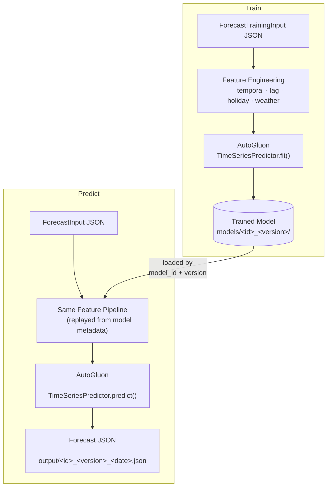
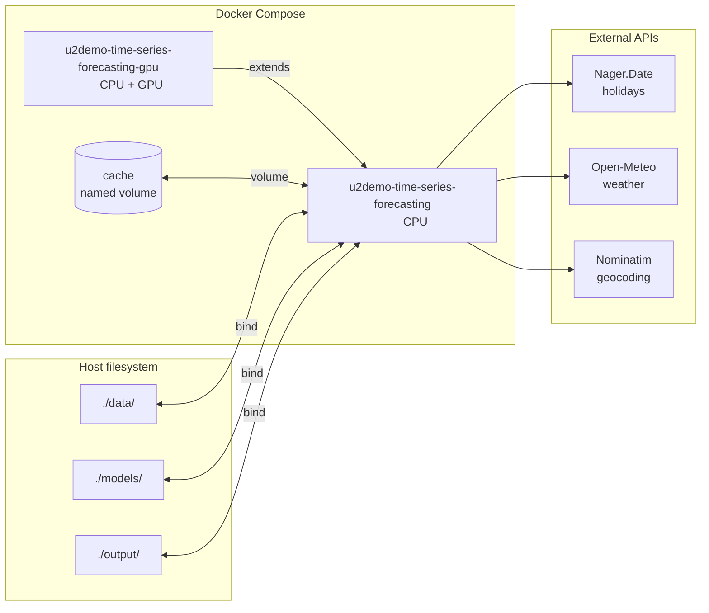

<div align="center"></div>

# U2Demo Time Series Forecasting

[](https://github.com/U2DemoProject/u2demo-time-series-forecasting-wp4t2/actions/workflows/ci.yml)
[](https://github.com/U2DemoProject/u2demo-time-series-forecasting-wp4t2/blob/main/LICENSE)
[](https://www.python.org/downloads/release/python-3120/)
[](https://github.com/U2DemoProject/u2demo-time-series-forecasting-wp4t2/actions/workflows/ci.yml)

Train and run inference on time-series forecasting models using [AutoGluon](https://auto.gluon.ai/), with automatic feature engineering (temporal, lag, holiday, weather) for hourly or daily data.

This is the output of the forecasting algorithms developed in task 4.2. It is the source code for the time series forecasting algorithm used in the U2Demo project. It is used to train models for the forecasting of time series and perform inference on them.

Models trained with this application will contain custom metadata that is relevant to the specific nature of the U2Demo project. This metadata will be read automatically when performing inference using this application. This ensures that new data will only be accepted by models that were trained on sufficiently similarly-shaped training data.

Models can be trained using hourly or daily timestep frequency.

> This document has been produced in the context of the U2Demo project. Views and opinions expressed in this document are however those of the authors only and do not necessarily reflect those of the European Union or the European Climate, Infrastructure and Environment Executive Agency (CINEA). Neither the European Union nor the granting authority can be held responsible for them. U2Demo has received funding from the European Union's Horizon Europe programme under grant agreement no. 101160684.

## Contents

- [Project structure](#project-structure)
- [Install](#install)
- [Use](#use)
  - [Input format](#input-format)
  - [Sanity check](#sanity-check)
  - [Train](#train)
  - [Predict](#predict)
  - [Python API](#python-api)
- [Docker](#docker)
- [Configuration](#configuration)
- [Test](#test)
- [Troubleshooting](#troubleshooting)
- [Contributing](#contributing)
- [License](#license)

## Project structure

```
.
├── u2demo_time_series_forecasting/   # main package
│   ├── cli.py                        # CLI entry point (u2demo-forecast)
│   ├── train.py                      # training logic
│   ├── predict.py                    # inference logic
│   ├── data_models.py                # Pydantic input/output models
│   ├── metadata.py                   # model metadata read/write
│   ├── features/                     # feature engineering
│   │   ├── pipeline.py
│   │   ├── temporal.py
│   │   ├── lag.py
│   │   ├── holidays.py
│   │   └── weather.py
│   └── constants/                    # env vars, column names, paths
├── data/                             # example input JSON files
├── models/                           # trained models (written by train)
├── output/                           # forecast JSON results (written by predict)
├── tests/                            # test suite
├── examples/                         # Jupyter notebooks
├── scripts/                          # utility scripts
├── Dockerfile
├── docker-compose.yml
└── pyproject.toml
```

## Install

Requires **Python 3.12** (`>=3.12, <3.13`). GPU is optional but recommended for training. AutoGluon does not publish hard minimum system requirements — see their [FAQ](https://auto.gluon.ai/stable/tutorials/timeseries/forecasting-faq.html) for instance sizing guidance.

This repo uses [Poetry](https://python-poetry.org/docs/#installing-with-the-official-installer) version **2.3.2**

```sh
poetry install
```

To install dev tools:

```sh
poetry install --with dev
```

To run the [example notebooks](examples/), install the optional `examples` group:

```sh
poetry install --with examples
```

## Use

The application has two main operations — **train** and **predict** — that share the same feature engineering pipeline:



### Input format

Both `train` and `predict` take a single JSON file as input. The JSON must validate against the `ForecastTrainingInput` or `ForecastInput` Pydantic models.

Training payload structure (see [`data/dummy_train.json`](data/dummy_train.json) for a full runnable example):

```json
{
  "forecast_type": "stochastic",
  "time_parameters": { "timestep_minutes": 60, "horizon_hours": 24 },
  "model_config": {
    "model_id": "dummy_model",
    "model_version": "1.0.0",
    "model_preset": "fast_training",
    "lookback_steps": 500
  },
  "target_series": {
    "series_id": "meter_pavilion_1",
    "variable_name": "energyImportTotal",
    "unit": "kWh",
    "training_values": [
      { "time": "2024-09-18T13:00:00", "value": 25.57 },
      { "time": "2024-09-18T14:00:00", "value": 31.16 },
      "..."
    ]
  },
  "location": { "latitude": 52.07, "longitude": 4.30 },
  "features": ["temporal", "lag", "holiday", "weather"],
  "num_weekly_lags": 2
}
```

`training_values` must contain enough data points so that the time series length is at least `lookback_steps + horizon + max(lag)`. The exact minimum depends on your `model_config.lookback_steps`, `time_parameters.horizon_hours`, and `num_weekly_lags`.

`model_preset` maps to AutoGluon's [`presets`](https://auto.gluon.ai/stable/api/autogluon.timeseries.TimeSeriesPredictor.fit.html) argument. Common values: `"fast_training"` (quick statistical/tree models), `"medium_quality"` (adds deep learning), `"high_quality"` (best accuracy, slowest). When omitted, the default is `"Chronos2Model"` (Chronos-2 zero-shot only).

The `features` list controls which feature engineering steps run. To train fully offline (no calls to Nager.Date, Open-Meteo, or Nominatim), use `["temporal", "lag"]` and omit `location`.

Trained models are written to `./models/<model_id>_<model_version>/`.
Forecast outputs are written to `./output/<model_id>_<model_version>_<forecast_date>.json`.

### Sanity check

Check availability of CUDA and compatible devices:

```sh
poetry run u2demo-forecast sanity_check
```

A CUDA-capable GPU is strongly encouraged, especially for training. CPU-only training works but is significantly slower, particularly when using deep-learning presets (`medium_quality`, `high_quality`, `chronos2`).

### Train

The `train` command reads a `ForecastTrainingInput` JSON file, validates it, engineers temporal/lag/holiday/weather features, and fits an AutoGluon `TimeSeriesPredictor`.

```sh
poetry run u2demo-forecast train data/dummy_train.json
```

> This example uses all four feature types, which require network access (holiday and weather APIs). For fully offline training, set `"features": ["temporal", "lag"]` and remove `"location"` from your JSON. See [Input format](#input-format) above.

### Predict

The `predict` command reads a `ForecastInput` JSON file, loads the matching trained model, replays the exact same feature engineering pipeline used at training time, and writes a `Forecast` JSON under `./output/`.

Forecast payload structure (see [`data/dummy_predict.json`](data/dummy_predict.json) for a full runnable example):

```json
{
  "forecast_type": "stochastic",
  "time_parameters": { "timestep_minutes": 60, "horizon_hours": 24 },
  "model_id": "dummy_model",
  "model_version": "1.0.0",
  "target_series": {
    "series_id": "meter_pavilion_1",
    "variable_name": "energyImportTotal",
    "unit": "kWh",
    "historical_values": [
      { "time": "2026-02-27T00:00:00", "value": 8.71 },
      { "time": "2026-02-27T01:00:00", "value": 8.75 },
      "..."
    ]
  },
  "location": { "latitude": 52.07, "longitude": 4.30 }
}
```

Note that `model_id` and `model_version` are top-level fields (not nested inside `model_config` as in the training input). The `features` and `num_weekly_lags` fields are not needed — the model reads its feature configuration from the metadata saved at training time.

All examples below assume `dummy_model_1.0.0` already exists in `./models`.
Run the `train` command above once to generate it.

```sh
poetry run u2demo-forecast predict data/dummy_predict.json
```

### Python API

This package also exposes a Python API. Import `train` and `predict` directly instead of going through the CLI:

```python
from u2demo_time_series_forecasting import train, predict, ForecastTrainingInput, ForecastInput
```

The data models (`ForecastTrainingInput`, `ForecastInput`, `Forecast`) accept the same JSON structure shown above. See the [example notebooks](examples/) for usage.

## Docker

Two services are defined — a CPU service and a GPU variant that extends it. All bind mounts are relative to the project root on the host:



To build a Docker image, use the provided `build.sh` script. It builds the image from the committed `requirements.txt` (kept up-to-date by the `poetry-export` pre-commit hook). Pass `--latest` to also tag as `latest`:

```sh
./build.sh dev --latest
```

Any command shown above can be run in Docker via `docker compose run --rm` (CPU):

```sh
docker compose run --rm u2demo-time-series-forecasting sanity_check
docker compose run --rm u2demo-time-series-forecasting train data/dummy_train.json
docker compose run --rm u2demo-time-series-forecasting predict data/dummy_predict.json
```

To use your system's GPU in a Docker container, install the [NVIDIA Container Toolkit](https://docs.nvidia.com/datacenter/cloud-native/container-toolkit/latest/install-guide.html) and use the `gpu` profile:

```sh
docker compose run --rm u2demo-time-series-forecasting-gpu sanity_check
docker compose run --rm u2demo-time-series-forecasting-gpu train data/dummy_train.json
docker compose run --rm u2demo-time-series-forecasting-gpu predict data/dummy_predict.json
```

## Configuration

All environment variables are optional with sensible defaults. Copy `.env_template` to `.env` and adjust as needed:

```sh
cp .env_template .env
```

See [`.env_template`](.env_template) for the full list of configurable variables (logging, Nominatim geocoding, holiday and weather API URLs).

## Test

Tests require the dev dependencies:

```sh
poetry install --with dev
```

### Test markers

Tests are organized into three categories using pytest markers:

| Marker | What it covers | Requirements |
|--------|---------------|--------------|
| `unit` | Fast, isolated tests with mocked externals | None |
| `integration` | Real AutoGluon models, real API calls | Network access, external APIs available |
| `e2e` | Full train-then-predict pipeline with Chronos2 | Chronos2 model download (~500MB first run) |

### Running tests

```sh
# All tests
poetry run pytest

# Unit tests only
poetry run pytest -m "not e2e and not integration"

# End-to-end tests (trains real Chronos2 models)
poetry run pytest -m e2e

# Integration tests (real AutoGluon models + external API calls)
poetry run pytest -m integration

# Single file
poetry run pytest tests/test_dataset.py
```

To get a coverage summary (e.g. to paste into a PR description):

```sh
poetry run coverage report --format=markdown
```

## Troubleshooting

### Files in `models/` or `output/` are owned by root after training in Docker

The container runs as your host user (set `UID` and `GID` in `.env` — see `.env_template`). If those variables are unset the container defaults to root, which causes bind-mounted files to be owned by root. Fix existing directories once with:

```sh
sudo chown -R "$(id -u):$(id -g)" models/ output/
```

### `dummy_predict.json` weather fetch fails with 400

`dummy_predict.json` contains hardcoded timestamps. The Open-Meteo forecast API only serves data within ~3 months of today, so if the file has gone stale you will see a `400 Bad Request` when running `poetry run u2demo-forecast predict data/dummy_predict.json`.

Refresh the timestamps with:

```sh
poetry run python scripts/refresh_dummy_predict.py
```

### External API rate limits

Holiday and weather features call third-party APIs (Nager.Date, Open-Meteo, Nominatim). Calls are cached on disk under `./.cache/` and retried with exponential backoff. To run completely offline, set `"features": ["temporal", "lag"]` in your training input JSON and omit the `location` field.

## Contributing

See [CONTRIBUTING.md](CONTRIBUTING.md) for setup instructions, coding standards, and the git workflow.

## License

This project is licensed under the Apache License 2.0. See [LICENSE](LICENSE) for details.
