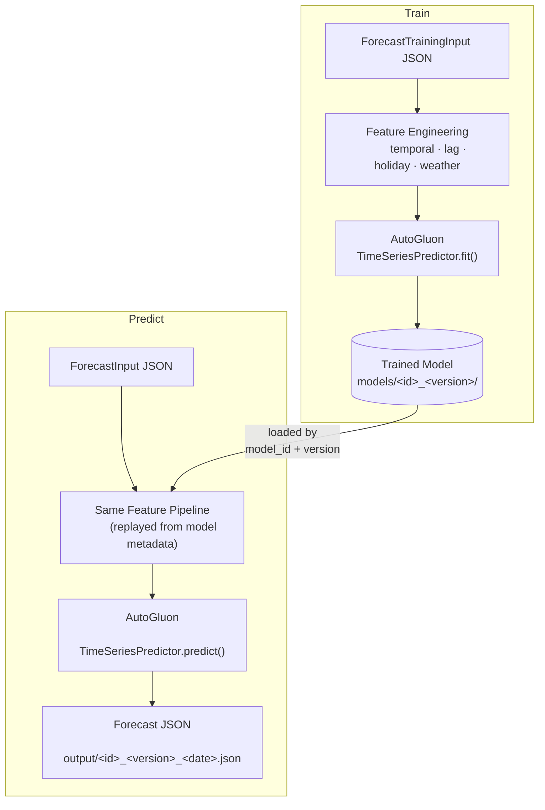
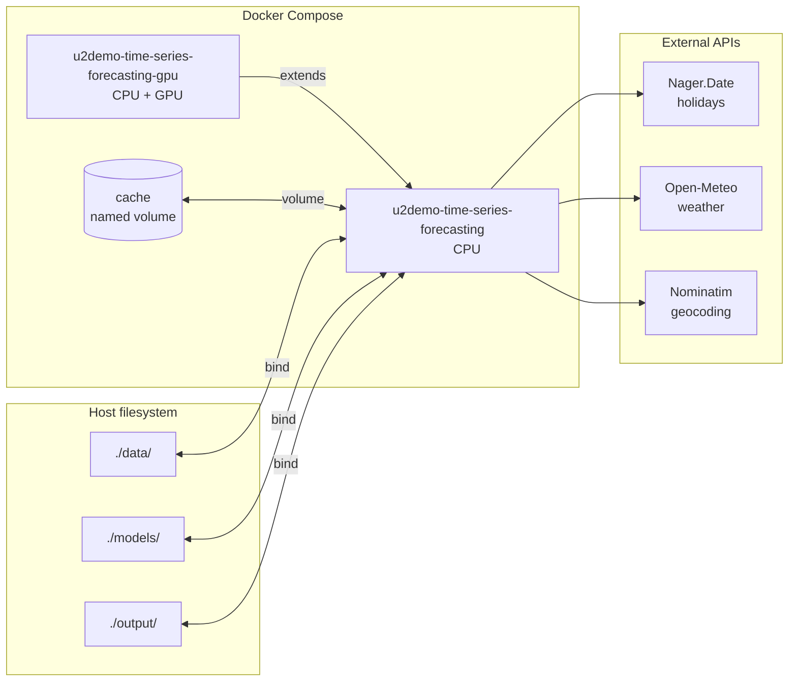

<div align="center"></div>

# U2Demo Time Series Forecasting

[](https://github.com/U2DemoProject/u2demo-time-series-forecasting-wp4t2/actions/workflows/ci.yml)
[](https://github.com/U2DemoProject/u2demo-time-series-forecasting-wp4t2/blob/main/LICENSE)
[](https://www.python.org/downloads/release/python-3120/)
[](https://github.com/U2DemoProject/u2demo-time-series-forecasting-wp4t2/actions/workflows/ci.yml)

Train and run inference on time-series forecasting models using [AutoGluon](https://auto.gluon.ai/), with automatic feature engineering (temporal, lag, holiday, weather) for regularly sampled data (e.g. 15-minute, hourly or daily).

This is the output of the forecasting algorithms developed in task 4.2. It is the source code for the time series forecasting algorithm used in the U2Demo project. It is used to train models for the forecasting of time series and perform inference on them.

Models trained with this application will contain custom metadata that is relevant to the specific nature of the U2Demo project. This metadata will be read automatically when performing inference using this application. This ensures that new data will only be accepted by models that were trained on sufficiently similarly-shaped training data.

Models can be trained on any regular timestep frequency, including sub-hourly ones (e.g. 15 minutes). Hourly weather data is aligned to each sub-hourly step.

> This document has been produced in the context of the U2Demo project. Views and opinions expressed in this document are however those of the authors only and do not necessarily reflect those of the European Union or the European Climate, Infrastructure and Environment Executive Agency (CINEA). Neither the European Union nor the granting authority can be held responsible for them. U2Demo has received funding from the European Union's Horizon Europe programme under grant agreement no. 101160684.

## Contents

- [Project structure](#project-structure)
- [Install](#install)
- [Use](#use)
  - [Input format](#input-format)
  - [Sanity check](#sanity-check)
  - [Train](#train)
  - [Predict](#predict)
  - [Python API](#python-api)
- [Data model versions](#data-model-versions)
- [Docker](#docker)
- [Configuration](#configuration)
- [Test](#test)
- [Troubleshooting](#troubleshooting)
- [Contributing](#contributing)
- [License](#license)

## Project structure

```
.
├── u2demo_time_series_forecasting/   # main package
│   ├── cli.py                        # CLI entry point (u2demo-forecast)
│   ├── train.py                      # training logic
│   ├── predict.py                    # inference logic
│   ├── data_models.py                # Pydantic input/output models (v1)
│   ├── data_models_v2.py             # Pydantic input/output models (v2) and v1 <-> v2 conversion
│   ├── versioning.py                 # payload version detection
│   ├── metadata.py                   # model metadata read/write
│   ├── features/                     # feature engineering
│   │   ├── pipeline.py
│   │   ├── temporal.py
│   │   ├── lag.py
│   │   ├── holidays.py
│   │   └── weather.py
│   └── constants/                    # env vars, column names, paths
├── data/                             # example input JSON files
├── models/                           # trained models (written by train)
├── output/                           # forecast JSON results (written by predict)
├── tests/                            # test suite
├── examples/                         # Jupyter notebooks
├── scripts/                          # utility scripts
├── Dockerfile
├── docker-compose.yml
└── pyproject.toml
```

## Install

Requires **Python 3.12** (`>=3.12, <3.13`). GPU is optional but recommended for training. AutoGluon does not publish hard minimum system requirements — see their [FAQ](https://auto.gluon.ai/stable/tutorials/timeseries/forecasting-faq.html) for instance sizing guidance.

This repo uses [Poetry](https://python-poetry.org/docs/#installing-with-the-official-installer) version **2.3.2**

```sh
poetry install
```

To install dev tools:

```sh
poetry install --with dev
```

To run the [example notebooks](examples/), install the optional `examples` group:

```sh
poetry install --with examples
```

## Use

The application has two main operations — **train** and **predict** — that share the same feature engineering pipeline:



### Input format

Both `train` and `predict` take a single JSON file as input. The JSON must validate against the `ForecastTrainingInput` or `ForecastInput` Pydantic models (v1), or against `ForecastTrainingInputV2` or `ForecastInputV2` (v2). The examples in this section use the v1 format; for the v2 format, see [Data model versions](#data-model-versions).

Training payload structure (see [`data/dummy_train.json`](data/dummy_train.json) for a full runnable example):

```json
{
  "forecast_type": "stochastic",
  "time_parameters": { "timestep_minutes": 60, "horizon_hours": 24 },
  "model_config": {
    "model_id": "dummy_model",
    "model_version": "1.0.0",
    "model_preset": "fast_training",
    "lookback_steps": 500
  },
  "target_series": {
    "series_id": "meter_pavilion_1",
    "variable_name": "energyImportTotal",
    "unit": "kWh",
    "training_values": [
      { "time": "2024-09-18T13:00:00", "value": 25.57 },
      { "time": "2024-09-18T14:00:00", "value": 31.16 },
      "..."
    ]
  },
  "location": { "latitude": 52.07, "longitude": 4.30 },
  "features": ["temporal", "lag", "holiday", "weather"],
  "num_weekly_lags": 2
}
```

`training_values` must contain enough data points so that the time series length is at least `lookback_steps + horizon + max(lag)`. The exact minimum depends on your `model_config.lookback_steps`, `time_parameters.horizon_hours`, and `num_weekly_lags`.

`model_preset` maps to AutoGluon's [`presets`](https://auto.gluon.ai/stable/api/autogluon.timeseries.TimeSeriesPredictor.fit.html) argument. Common values: `"fast_training"` (quick statistical/tree models), `"medium_quality"` (adds deep learning), `"high_quality"` (best accuracy, slowest). Single-model presets such as `"chronos2"` skip model selection. When omitted, the default is `"chronos2"` (Chronos-2 zero-shot only).

The `features` list controls which feature engineering steps run. To train fully offline (no calls to Nager.Date, Open-Meteo, or Nominatim), use `["temporal", "lag"]` and omit `location`.

Trained models are written to `./models/<model_id>_<model_version>/`.
Forecast outputs are written to `./output/<model_id>_<model_version>_<forecast_date>.json`.

### Sanity check

Check availability of CUDA and compatible devices:

```sh
poetry run u2demo-forecast sanity_check
```

A CUDA-capable GPU is strongly encouraged, especially for training. CPU-only training works but is significantly slower, particularly when using deep-learning presets (`medium_quality`, `high_quality`, `chronos2`).

### Train

The `train` command reads a `ForecastTrainingInput` (or `ForecastTrainingInputV2`) JSON file, validates it, engineers temporal/lag/holiday/weather features, and fits an AutoGluon `TimeSeriesPredictor`.

```sh
poetry run u2demo-forecast train data/dummy_train.json
```

> This example uses all four feature types, which require network access (holiday and weather APIs). For fully offline training, set `"features": ["temporal", "lag"]` and remove `"location"` from your JSON. See [Input format](#input-format) above.

### Predict

The `predict` command reads a `ForecastInput` (or `ForecastInputV2`) JSON file, loads the matching trained model, replays the exact same feature engineering pipeline used at training time, and writes a `Forecast` JSON under `./output/` (a `ForecastV2` for a v2 request).

Forecast payload structure (see [`data/dummy_predict.json`](data/dummy_predict.json) for a full runnable example):

```json
{
  "forecast_type": "stochastic",
  "time_parameters": { "timestep_minutes": 60, "horizon_hours": 24 },
  "model_id": "dummy_model",
  "model_version": "1.0.0",
  "target_series": {
    "series_id": "meter_pavilion_1",
    "variable_name": "energyImportTotal",
    "unit": "kWh",
    "historical_values": [
      { "time": "2026-02-27T00:00:00", "value": 8.71 },
      { "time": "2026-02-27T01:00:00", "value": 8.75 },
      "..."
    ]
  },
  "location": { "latitude": 52.07, "longitude": 4.30 }
}
```

Note that `model_id` and `model_version` are top-level fields (not nested inside `model_config` as in the training input). The `features` and `num_weekly_lags` fields are not needed — the model reads its feature configuration from the metadata saved at training time.

All examples below assume `dummy_model_1.0.0` already exists in `./models`.
Run the `train` command above once to generate it.

```sh
poetry run u2demo-forecast predict data/dummy_predict.json
```

### Python API

This package also exposes a Python API. Import `train` and `predict` directly instead of going through the CLI:

```python
from u2demo_time_series_forecasting import train, predict, ForecastTrainingInput, ForecastInput
```

The data models (`ForecastTrainingInput`, `ForecastInput`, `Forecast`) accept the same JSON structure shown above. See the [example notebooks](examples/) for usage.

For v2 payloads, use `train_v2`, `predict_v2` and the v2 data models (`ForecastTrainingInputV2`, `ForecastInputV2`, `ForecastV2`), or `train_from_payload` and `predict_from_payload` for payloads of either version. See [Data model versions](#data-model-versions).

## Data model versions

Training and forecast payloads can use either of two versions of the U2Demo data models:

- **v1**: the format described in [Use](#use).
- **v2**: the vocabulary of the [U2Demo data models v2.0.0](https://github.com/U2DemoProject/U2DemoDataModels/tree/6075f75/v2.0.0). The forecast is a [`ForecastPayloadDM`](https://github.com/U2DemoProject/U2DemoDataModels/blob/6075f75/v2.0.0/api/components/forecast/ForecastPayloadDM.json), the payload the optimisation engines take as `hasForecastedProfile`. The v2 data models do not define the training and forecast requests: the v2 requests below are this library's own format, written with the v2 field names so that a request and its forecast describe a series the same way.

The forecast is written in the version of the request. v2 requests are converted to v1 and run through the same pipeline, so a model trained from a v1 request serves v2 forecast requests, and the other way round.

### v2 payloads

The v2 examples forecast the electricity consumption of the pavilion of the v1 examples, as the average power of its load over each hour, ready for the optimisation engines (see [Forecasts for the optimisation engines](#forecasts-for-the-optimisation-engines)). They train and use the model `dummy_pavilion_load_1.0.0`.

Training payload (see [`data/dummy_train_v2.json`](data/dummy_train_v2.json)):

```json
{
  "hasTimeParameters": { "timestep_minutes": 60, "horizon_hours": 24 },
  "hasUserForecastPreferences": {
    "forecast_type": "STOCHASTIC",
    "model_id": "dummy_pavilion_load",
    "model_version": "1.0.0",
    "model_preset": "fast_training",
    "lookback_steps": 500
  },
  "target_series": {
    "series_id": "pavilion_1_consumption",
    "observedProperty": "ActivePower",
    "hasFeatureOfInterest": "load_pavilion_1",
    "asset_type": "Load",
    "unit_symbol": "kW",
    "unit": "unit:KiloW",
    "training_values": [
      { "timestamp": "2024-09-18T13:00:00+00:00", "value": 5.5907 },
      { "timestamp": "2024-09-18T14:00:00+00:00", "value": 5.7403 },
      "..."
    ]
  },
  "location": { "latitude": 52.07, "longitude": 4.30 },
  "features": ["temporal", "lag", "holiday", "weather"],
  "num_weekly_lags": 2
}
```

Forecast payload (see [`data/dummy_predict_v2.json`](data/dummy_predict_v2.json)). `forecastId` is optional; a UUID4 is generated when it is missing:

```json
{
  "forecastId": "forecast-pavilion-1-2026-11-13",
  "forecast_type": "STOCHASTIC",
  "hasTimeParameters": { "timestep_minutes": 60, "horizon_hours": 24 },
  "model_id": "dummy_pavilion_load",
  "model_version": "1.0.0",
  "target_series": {
    "series_id": "pavilion_1_consumption",
    "observedProperty": "ActivePower",
    "hasFeatureOfInterest": "load_pavilion_1",
    "asset_type": "Load",
    "unit": "unit:KiloW",
    "historical_values": [
      { "timestamp": "2026-10-05T00:00:00+00:00", "value": 8.71 },
      { "timestamp": "2026-10-05T01:00:00+00:00", "value": 8.75 },
      "..."
    ]
  },
  "location": { "latitude": 52.07, "longitude": 4.30 }
}
```

Forecast written by `predict` (abridged: 24 hourly values, each with the 9 quantiles the model was trained with):

```json
{
  "forecastId": "forecast-pavilion-1-2026-11-13",
  "forecast_date": "2026-11-20T13:50:39.438127Z",
  "forecast_type": "STOCHASTIC",
  "hasForecastSeries": [
    {
      "series_id": "pavilion_1_consumption",
      "observedProperty": "ActivePower",
      "hasFeatureOfInterest": "load_pavilion_1",
      "unit_symbol": "kW",
      "unit": "unit:KiloW",
      "model_id": "dummy_pavilion_load_1.0.0",
      "hasValues": [
        {
          "timestamp": "2026-11-13T11:00:00Z",
          "hasResult": { "numericValue": 4.42, "unit": "unit:KiloW" },
          "quantiles": {
            "0.1": 3.92, "0.2": 3.98, "0.3": 4.26, "0.4": 4.3, "0.5": 4.42,
            "0.6": 4.78, "0.7": 5.44, "0.8": 5.73, "0.9": 6.75
          }
        },
        "..."
      ]
    }
  ]
}
```

### Forecasts for the optimisation engines

The optimisation engines read a forecast from the `hasForecastedProfile` of the asset it describes. The [v2 API payloads](https://github.com/U2DemoProject/U2DemoDataModels/tree/6075f75/v2.0.0/api) (`LoadPayloadDM`, `PVPayloadDM`, `HVACPayloadDM` and their examples) describe these series:

| Forecast | `observedProperty` | `unit` | `hasFeatureOfInterest` |
|---|---|---|---|
| Consumption of a load, or baseline of a flexible load | `ActivePower` | `unit:KiloW` | The id of the load asset |
| Production of a PV installation | `ActivePower` | `unit:KiloW` | The id of the PV asset |
| Outdoor temperature, for an HVAC | `OutdoorTemperature` | `unit:DEG_C` | The id of the facility |

`ActivePower` is the average power over each timestep. The library forecasts the quantity it is trained on and converts no units, so train these models on power. Meters often report the cumulative energy register (`ImportEnergy` in the v2 vocabulary); the energy of each timestep divided by the timestep duration is the average power. The v2 examples are built this way from the readings of the pavilion meter: over one hour, the kWh consumed equal the average power in kW. With 15-minute timesteps, the average power is four times the kWh of each quarter-hour.

### Field mapping

Requests:

| v1 | v2 | Notes |
|---|---|---|
| `forecast_type`: `deterministic`, `stochastic` | `forecast_type`: `DETERMINISTIC`, `STOCHASTIC` | In `hasUserForecastPreferences` for training, at the top level for forecasting |
| `time_parameters` | `hasTimeParameters` | Same fields: `timestep_minutes`, `horizon_hours`, `scheduling_time` |
| `model_config` | `hasUserForecastPreferences` | `model_id`, `model_preset`, `model_version`, `lookback_steps`, `quantile_levels`, `training_split` and `excluded_model_types` keep their names |
| `model_config.eval_metric` | `hasUserForecastPreferences.loss_function` | `mse` → `MSE`, `mae` → `MAE`, `pinball` → `WQL`, `rmse` → `RMSE`, `mape` → `MAPE`, `mase` → `MASE`; other values are passed upper-cased |
| `model_config.training_split` | `hasUserForecastPreferences.training_split`, `validation_ratio`, `test_ratio` | See [Training split](#training-split) |
| `target_series.variable_name` | `target_series.observedProperty` | Required, from the v2 vocabulary (`ActivePower`, `ImportEnergy`, `EnergyYield`, `OutdoorTemperature`, ...) |
| `target_series.asset_id` | `target_series.hasFeatureOfInterest` | Required: the id of the asset, or of the facility for a quantity of the whole facility such as the outdoor temperature |
| `target_series.unit` | `target_series.unit_symbol` | |
| `target_series.unitIri` (`http://qudt.org/vocab/unit/KiloW`) | `target_series.unit` (`unit:KiloW`) | See [Units](#units) |
| `training_values`, `historical_values`, `future_values`: `{time, value}` | Same names: `{timestamp, value}` | |
| `exogenous_series[].variable_name` | `exogenous_series[].variable_name`, `observedProperty` | See [Exogenous series](#exogenous-series) |
| | `forecastId` | Forecast requests only |

`location`, `features`, `num_weekly_lags`, `model_id` and `model_version` (forecast requests) and `asset_type` are the same in both versions. v2 requests reject unknown fields. The identifiers of the platform records (`timeParametersId` in `hasTimeParameters`, `ufpId` in `hasUserForecastPreferences`, and `hasActor` and `relatedToOptimizationInstance` in both) are accepted, so the records can be passed as they are, and are not used.

Forecast:

| v1 `Forecast` | v2 `ForecastV2` |
|---|---|
| | `forecastId`: from the request, or a new UUID4 |
| `forecast_type` | `forecast_type`, upper case |
| `forecast_date` | `forecast_date` |
| `time_parameters` | Not in the payload: the engines use the time parameters of their own request |
| `forecast_series` (an object) | `hasForecastSeries` (a list holding one series) |
| `series_id` | `series_id` |
| `variable_name` | `observedProperty` |
| `asset_id` | `hasFeatureOfInterest` |
| `asset_type` | Not in the payload |
| `unit` | `unit_symbol` |
| `unitIri` | `unit` |
| | `model_id`: `<model_id>_<model_version>`, the directory of the trained model |
| `values[]`: `time`, `value`, `quantiles` | `hasValues[]`: `timestamp`, `hasResult: {numericValue, unit}`, `quantiles` |

`quantiles` are only written for a `STOCHASTIC` forecast. The v2 schemas reject `null`, so `ForecastV2` leaves optional fields without a value out of every dump: any `model_dump_json()` of a `ForecastV2` is a valid `ForecastPayloadDM`.

### Units

`unit` is a QUDT unit IRI in compact form, such as `unit:KiloW`. A series can give `unit`, `unit_symbol` or both; when one of them is missing, it is derived from this table:

| `unit_symbol` | `unit` |
|---|---|
| `W` | `unit:W` |
| `kW` | `unit:KiloW` |
| `MW` | `unit:MegaW` |
| `Wh` | `unit:W-HR` |
| `kWh` | `unit:KiloW-HR` |
| `MWh` | `unit:MegaW-HR` |
| `°C` | `unit:DEG_C` |
| `%` | `unit:PERCENT` |
| `EUR/MWh` | `unit:CCY_EUR-PER-MegaW-HR` |

Other units need `unit`. The target series is rejected when its `unit` cannot be resolved, and a series is rejected when its `unit_symbol` and `unit` are two different units of the table, such as `kW` with `unit:KiloW-HR`. Pairs outside the table are not checked: `%` with `unit:PERCENT_RH` is accepted. The unit is declared once, on the series: the values stay `{timestamp, value}`, since a unit per value would only repeat it over years of history. The forecast repeats the unit of the target in every `hasResult`, as `ForecastPayloadDM` requires.

### Training split

As in v1, `training_split.num_val_windows` and `training_split.num_test_windows` are numbers of windows of one forecast horizon, which AutoGluon backtests on. A v2 training request can give `validation_ratio` and `test_ratio` instead: a missing window count is then derived from the matching ratio as `max(1, floor(ratio * n_steps / horizon_steps))`, where `n_steps` is the number of training values and `horizon_steps` the horizon in timesteps. This needs `hasTimeParameters.timestep_minutes`. A window count takes precedence over a ratio. `training_ratio` is accepted, but training always uses the data before the validation and test windows. The ratios must not add up to more than 1. On long histories, ratios give many windows and slow training down; set the window counts to keep it short.

Preferences that are left out take the v1 defaults: `model_preset` `chronos2`, the `WQL` metric, one validation and one test window. A preference set to `null` behaves as in a v1 request.

### Exogenous series

An exogenous series has a `variable_name`, an `observedProperty`, or both. `variable_name` is the name of its column in the model and defaults to `observedProperty`. A trained model stores the names of its known covariates, so the names must be the same at training and at forecast time, across versions too: a series trained in v1 as `"variable_name": "temperature"` needs `"variable_name": "temperature"` in a v2 forecast request, not only `"observedProperty": "OutdoorTemperature"`. `is_known_covariate`, `future_values`, `source`, `unit_symbol` and `unit` work as in v1.

### Timestamps

v2 timestamps are ISO 8601 with a UTC offset. Use UTC: as in v1, the pipeline keeps the wall-clock time of the timestamps and drops their offset, and it fetches weather data in UTC, so another offset shifts the weather features (and a change of offset, such as a daylight saving time change, makes the series irregular). Timestamps without an offset are read as UTC. The forecast timestamps get the offset of the last historical value, or UTC when it has none.

### Choosing the version

The CLI detects the version of the payload and writes the forecast in the same version. `--version` sets it explicitly:

```sh
poetry run u2demo-forecast train data/dummy_train_v2.json
poetry run u2demo-forecast predict data/dummy_predict_v2.json
poetry run u2demo-forecast predict data/dummy_predict_v2.json --version v2
```

A payload is detected as v2 when it has any of:

- a top-level key that only exists in v2: `hasTimeParameters`, `hasUserForecastPreferences` or `forecastId`;
- a `forecast_type` in upper case: `DETERMINISTIC` or `STOCHASTIC`;
- a `target_series` with `observedProperty` or `hasFeatureOfInterest`.

Any other payload is v1. A payload that also has v1 fields (`time_parameters`, `model_config`, `training_model_config`, a lower-case `forecast_type`, or `variable_name`, `asset_id` or `unitIri` in `target_series`) is rejected with an error naming the fields of both versions, rather than guessed. The detected version is logged at INFO level.

v1 payloads without fields of these v2 names are detected as v1 and work as before. Because v1 accepts unknown fields, a v1 payload that carries a field with one of these v2 names (for example a `forecastId`) is rejected as mixed: send it with `--version v1`.

An explicit version skips the detection: the payload is validated against that version, and a payload of the other version fails validation.

In Python:

```python
from u2demo_time_series_forecasting import (
    ForecastInputV2,
    ForecastTrainingInputV2,
    predict_from_payload,
    predict_v2,
    train_v2,
)

train_v2(ForecastTrainingInputV2.model_validate(training_payload))
forecast = predict_v2(ForecastInputV2.model_validate(forecast_payload))
forecast_json = forecast.model_dump_json()

# Payloads of either version: returns a Forecast (v1) or a ForecastV2 (v2)
forecast = predict_from_payload(payload)
forecast = predict_from_payload(payload, version="v2")
```

`train_from_payload` is the training counterpart, `detect_payload_version(payload)` returns `"v1"` or `"v2"`, and `forecast_to_v2(forecast, request)` converts a v1 `Forecast` to a `ForecastV2`.

### Not covered

- `ForecastedConnectionSession` (predicted EV arrival and departure times, with quantiles) is the forecast of an event, not a time series, and the v2 data models have no JSON schema for it yet.
- HTTP routes: this library has no HTTP API. Serving v2 payloads over HTTP is up to the forecasting service built on it (`u2demo-time-series-forecasting-as-a-service-WP4T2`).
- Several series per forecast: v2 allows several series in a forecast, but a model forecasts the one target series of its request, so `hasForecastSeries` always holds one series.

## Docker

Two services are defined — a CPU service and a GPU variant that extends it. All bind mounts are relative to the project root on the host:



To build a Docker image, use the provided `build.sh` script. It builds the image from the committed `requirements.txt` (kept up-to-date by the `poetry-export` pre-commit hook). Pass `--latest` to also tag as `latest`:

```sh
./build.sh dev --latest
```

Any command shown above can be run in Docker via `docker compose run --rm` (CPU):

```sh
docker compose run --rm u2demo-time-series-forecasting sanity_check
docker compose run --rm u2demo-time-series-forecasting train data/dummy_train.json
docker compose run --rm u2demo-time-series-forecasting predict data/dummy_predict.json
```

To use your system's GPU in a Docker container, install the [NVIDIA Container Toolkit](https://docs.nvidia.com/datacenter/cloud-native/container-toolkit/latest/install-guide.html) and use the `gpu` profile:

```sh
docker compose run --rm u2demo-time-series-forecasting-gpu sanity_check
docker compose run --rm u2demo-time-series-forecasting-gpu train data/dummy_train.json
docker compose run --rm u2demo-time-series-forecasting-gpu predict data/dummy_predict.json
```

## Configuration

All environment variables are optional with sensible defaults. Copy `.env_template` to `.env` and adjust as needed:

```sh
cp .env_template .env
```

See [`.env_template`](.env_template) for the full list of configurable variables (logging, Nominatim geocoding, holiday and weather API URLs).

## Test

Tests require the dev dependencies:

```sh
poetry install --with dev
```

### Test markers

Tests are organized into three categories using pytest markers:

| Marker | What it covers | Requirements |
|--------|---------------|--------------|
| `unit` | Fast, isolated tests with mocked externals | None |
| `integration` | Real AutoGluon models, real API calls | Network access, external APIs available |
| `e2e` | Full train-then-predict pipeline with Chronos2 | Chronos2 model download (~500MB first run) |

### Running tests

```sh
# All tests
poetry run pytest

# Unit tests only
poetry run pytest -m "not e2e and not integration"

# End-to-end tests (trains real Chronos2 models)
poetry run pytest -m e2e

# Integration tests (real AutoGluon models + external API calls)
poetry run pytest -m integration

# Single file
poetry run pytest tests/test_dataset.py
```

To get a coverage summary (e.g. to paste into a PR description):

```sh
poetry run coverage report --format=markdown
```

## Troubleshooting

### Files in `models/` or `output/` are owned by root after training in Docker

The container runs as your host user (set `UID` and `GID` in `.env` — see `.env_template`). If those variables are unset the container defaults to root, which causes bind-mounted files to be owned by root. Fix existing directories once with:

```sh
sudo chown -R "$(id -u):$(id -g)" models/ output/
```

### `dummy_predict.json` weather fetch fails with 400

`dummy_predict.json` contains hardcoded timestamps. The Open-Meteo forecast API only serves data within ~3 months of today, so if the file has gone stale you will see a `400 Bad Request` when running `poetry run u2demo-forecast predict data/dummy_predict.json`. The same applies to `dummy_predict_v2.json`.

Refresh the timestamps of both files with:

```sh
poetry run python scripts/refresh_dummy_predict.py
```

### External API rate limits

Holiday and weather features call third-party APIs (Nager.Date, Open-Meteo, Nominatim). Calls are cached on disk under `./.cache/` and retried with exponential backoff. To run completely offline, set `"features": ["temporal", "lag"]` in your training input JSON and omit the `location` field.

## Contributing

See [CONTRIBUTING.md](CONTRIBUTING.md) for setup instructions, coding standards, and the git workflow.

## License

This project is licensed under the Apache License 2.0. See [LICENSE](LICENSE) for details.
